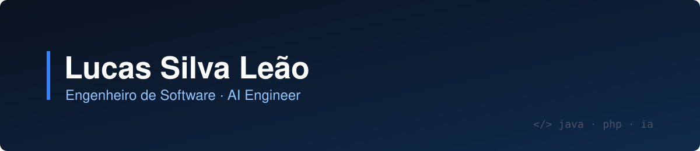

### Sobre mim

- Engenheiro de Software e AI Engineer no Procon/AC
- Digitalização de processos em papel com sistemas web e automações, reduzindo em **70%** o tempo de atendimento
- APIs REST, arquitetura em camadas, Clean Code, SOLID e integração entre sistemas
- IA aplicada: LLMs locais com Ollama, engenharia de prompt, RAG e agentes para automação de fluxos

### Stack

- **Backend:** Java + Spring Boot (principal) · PHP + Laravel (trabalho)
- **IA:** Python, LLMs, Ollama
- **Dados e ferramentas:** MySQL, PostgreSQL, Git

### Contato

[GitHub](https://github.com/lucassleao) · [LinkedIn](https://www.linkedin.com/in/lucasleaolsldev)

